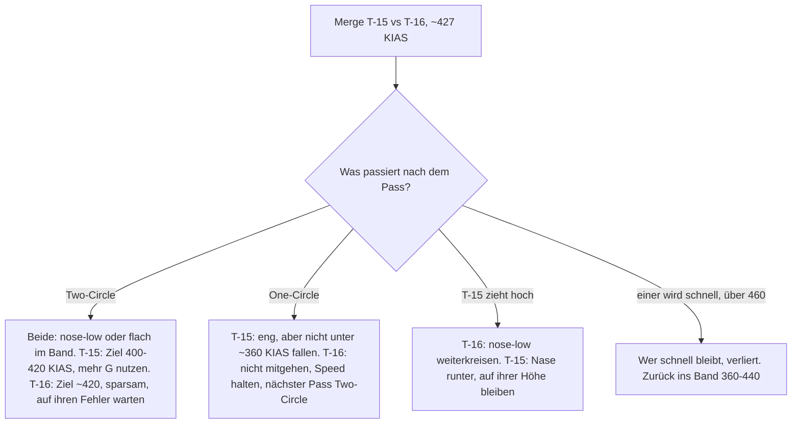

# T-15 vs. T-16

> Kraft gegen Rate: Die T-16 dreht im Band ~420–500 KIAS dauerhaft 1–2 °/s schneller. Trotzdem gewinnt die T-15 laut Simulation genau diesen Kampf – den Two-Circle bei ~360–440 KIAS, nose-low. Die T-16 gewinnt, wenn die T-15 hochzieht oder schnell wird.

## Was entscheidet

| | T-15 | T-16 | Quelle |
|---|---|---|---|
| Sustained bei ~450 KIAS | 15,4 °/s (7,0 G) | **17,6 °/s** (7,9 G) | gemessen |
| Max Sustained (10.000 ft) | 17 °/s @ 495 | **18 °/s** @ 470 | Diagramm |
| Max Instant (10.000 ft) | **24 °/s** @ 360 | 21 °/s @ 409 | Diagramm |
| Min Radius (10.000 ft) | **1.644 ft** | 2.099 ft | Diagramm |
| G bei gleicher Speed (≈355 KIAS) | **6,8 G** | 5,8 G | gemessen |
| Schub/Gewicht mit Nachbrenner (10.000 ft) | **1,65** | 1,26 | gemessen (Spieldaten 1,64 / 1,29) |
| Erster Turn aus 450 KIAS, nach 8 s | **146°**, danach ~286 KIAS | 141° sustained, hält ~450 KIAS | gemessen |
| 300 → 500 KIAS mit Nachbrenner | **~8,4 s** | ~11,5 s | gemessen |
| Energieverlust im vollen Zug | ~2,3-mal so hoch | **am geringsten** | gemessen |
| Rollrate (Vorgabe des Fly-by-Wire) | 325 °/s | **420 °/s** | Spieldaten, im Flug nicht gemessen |

Die T-15 ist in fast jeder Zeile vorn. Die T-16 hat eine Waffe: 1–2 °/s mehr Sustained Rate im Band ~420–500 KIAS, grob 20–40° pro Kreis, und sie rollt laut Spieldaten schneller. Alle Daten: [Flugzeugvergleich](/flugzeuge/vergleich).

**Ranked-Start** (*Replays*): 10.000 ft, ~427 KIAS (Mach 0,75), Head-on, 13.100 ft Abstand, ~1.300 ft seitlicher Versatz, Merge nach ~8 s, voller Tank. Vor dem ersten Pass fällt kein Schuss; bis zum Abschuss vergehen im Median ~2,5 Minuten, in 90 % der Runden unter 5.

## Wer dreht wo besser? (Diagramm, gemessen) {#wer-gewinnt-wo}

| Bereich / Flow | Vorteil im Rate-Vergleich | Warum |
|---|---|---|
| Unter ~380 KIAS | **T-15 klar** | ~20 % engere Kreise, mehr G bei gleicher Speed, mehr Sustained Rate. Hier ist die T-16 am schwächsten. |
| ~380–420 KIAS | Übergang | Die Sustained-Kurven kreuzen sich. |
| ~420–500 KIAS, flach | **T-16** | +1–2 °/s Sustained, auf Meereshöhe am meisten (22 vs 20 °/s). |
| Über ~520 KIAS | **T-15** | Die T-16 fällt ab, die T-15 hält ihre Rate. |
| ~20.000 ft | **T-15** | T-16-Vorsprung nur 0–1 °/s; die T-15 behält Instant, Radius und das flachste Sustained-Plateau. |
| Beschleunigung, Extend mit Abstand | **T-15** | ~40 % mehr Schubüberschuss. |
| T-15 zieht hoch, T-16 nose-low | **T-16** | Die T-15 verliert im harten Zug Energie ~2,3-mal so schnell; die T-16 tauscht Höhe gegen Speed und bleibt im Band. |

## Diagramm gegen Simulation

Die Tabelle oben zeigt, wer in welchem Band **dauerhaft schneller dreht**. Das gilt weiter. Die [Simulation](/flugzeuge/simulation#t-15-gegen-t-16) zeigt, was **im ganzen Kampf** gewinnt – und kommt zu einem anderen Schluss als der alte Spielplan („T-15: Two-Circle bei 400–500 meiden, langsamen One-Circle erzwingen“):

- **Den Two-Circle bei ~360–440 KIAS gewinnt die T-15**, nose-low am deutlichsten (+0,88 gegen ein breites Feld, flach +0,76). Ihre 1–2 °/s weniger Rate gleicht sie mit mehr G bei gleicher Speed, dem kleineren Radius und dem viel größeren Schubüberschuss aus: Sie holt Energie schneller zurück und hat öfter die Nase für einen Schuss.
- **Der langsame One-Circle** (in der Simulation 280 KIAS) gewinnt für die T-15 nur halb so deutlich (+0,43). Hoher α kostet im Originalmodell so viel Energie, dass auch sie aus dem Loch schlecht herauskommt.
- **Schnell durchfliegen und hochziehen verliert** (−0,31), vertikal halbiert ihren Vorteil.
- **Die T-16** ist mit ihrer besten Familie, dem Two-Circle bei ~440 KIAS (flach +0,54), immer noch unterlegen (Spielwert −0,27). Bei ~360 ist sie nur noch ausgeglichen, langsamer verliert sie.

Allgemein erklärt: [Diagramm und Simulation](/flugzeuge/vergleich#diagramm-und-simulation). Grenze: Die Bots zielen perfekt, planen nicht voraus und fliegen mit derselben Rollrate. Laut Spieldaten rollt die T-15 am langsamsten; real könnte der Vorsprung kleiner sein (*Hypothese*).

## Als T-15

### Plan

**Two-Circle, nose-low, Ziel-Speed ~400–420 KIAS** (geflogen ~385–420, Band 360–440). Am Pass zu ihr hin drehen, Lift Vector leicht unter den Horizont, Speed im Band halten. Dort ziehst du bei gleicher Speed mehr G und fliegst den kleineren Kreis; ihre bessere Rate wirkt erst über viele saubere Kreise.

- **Nicht schnell werden:** Über ~460 KIAS verlierst du gegen die T-16 deutlich.
- **Nicht hochziehen:** Vertikal halbiert deinen Vorteil (siehe [Fehler: T-15 zieht hoch](/VFM_Wiki/sim/?szenario=t15-hochziehen){target="_self"}).
- **Wird sie langsam**, unter ~380 KIAS, bist du dort in jeder Kennzahl vorn. Den Kampf bewusst auf 280 KIAS herunterzuziehen, lohnt sich aber nicht.

### Merge

Den ersten Turn nicht um jeden Preis gewinnen. Voll gezogen holst du aus 450 KIAS nur ~5° und kommst bei ~286 KIAS heraus, weit unter deinem Band, während sie im Sustained-Turn ~450 hält ([Der erste Turn aus 450 KIAS](/grundlagen/neutral/der-merge#der-erste-turn-aus-450-kias-gemessen)). Im Modell aus dem echten Ranked-Start ist der Vorsprung größer (nach 8 s ab Zugbeginn 131° voll gegen 114° sustained), die Speed aber genauso weg (~276 KIAS). Zieh also hart, aber bring die Speed danach zügig ins Band zurück. Der Versatz von ~1.300 ft ist kleiner als ein Wenderadius, viel Raum für einen Lead Turn hat keiner. **Geht sie nose-low, geh mit, statt hochzuziehen.** Mehr: [Merge-Strategien für Ranked](/grundlagen/neutral/der-merge#merge-strategien-fur-ranked-start-450-kias), [One-Circle vs. Two-Circle](/grundlagen/neutral/one-two-circle).

### Was du vermeidest

- **Hochziehen gegen eine abtauchende T-16.** Nach einem Kreis ist sie unten, schnell und dreht besser; du bist oben und langsam. Nase runter, auf ihrer Höhe bleiben, den Kampf eng halten. In der Praxis kostet das mehr als in der Simulation: Menschen werden oben zusätzlich ungeduldig.
- **Durchfliegen und Extend am ersten Merge.** In der Simulation die schlechteste Wahl.
- **Unnötige Vollzüge.** Jede Sekunde Vollzug kostet dich rund zwei Sekunden Extend-Vorsprung.
- **Extend aus der Defensive.** Sitzt sie hinter dir, bringt dir dein Schub in den ersten Sekunden kaum Abstand: nach 5 s ~160 ft, nach 10 s ~700 ft, bei ~75 kt mehr Speed (gemessen). Erst [Guns Defense](/grundlagen/defensiv/guns-defense), dann Energie.

**Raketen-Lobbys** (nicht Ranked, Ranked 1v1 ist Guns-only): Den ersten Fox-2-Schuss bekommst du nur mit ~5° Vorsprung; im ausgeflogenen Two-Circle bei 420–500 KIAS dreht sie schneller.

## Als T-16

### Plan

**Two-Circle bei ~420–440 KIAS, flach oder nose-low**, in Lag und sparsam geflogen. Das ist deine beste Familie, gegen eine sauber fliegende T-15 aber nicht genug – du brauchst ihre Fehler: Hochziehen, schnell werden, Ungeduld. Ziel-Speed **~420 KIAS** (geflogen ~420–440): Dein Sustained-Optimum liegt zwar bei ~460–470, aber das Plateau ist flach. Bei 420 gibst du nur ~0,2–0,3 °/s her und fliegst einen ~9 % kleineren Kreis (10.000 ft, voll: 3.250 → 2.940 ft). Gegen eine T-15 mit vollem Tank ist ~470 nicht schlechter; mit sinkendem Fuel wird die niedrigere Speed besser – **nie schneller werden, wenn der Tank leerer wird**. Details: [T-16, Speed nach Fuel und Höhe](/flugzeuge/t16#speed-nach-fuel-und-hohe).

### Merge

Dreh den ersten Turn **sustained**: gemessen 17,6 °/s, nach 8 s 141°, Speed bleibt bei ~450 KIAS; voll ziehen bringt dort keinen Winkel mehr, kostet aber ~85 KIAS ([Der erste Turn aus 450 KIAS](/grundlagen/neutral/der-merge#der-erste-turn-aus-450-kias-gemessen)). Im Modell aus dem echten Ranked-Start bringt voller Zug ~12° mehr (126° gegen 114°), aber du bist danach bei ~368 KIAS, also unter deinem Band. Den Rückstand im ersten Turn nimmst du hin; sie ist danach viel langsamer. Fliegt sie One-Circle, geh nicht mit, sondern wähle am nächsten Pass Two-Circle. **Zieht sie hoch: nose-low weiterkreisen**, nie hinterher. Mehr: [Merge-Strategien für Ranked](/grundlagen/neutral/der-merge#merge-strategien-fur-ranked-start-450-kias).

### Was du vermeidest

- **Vertikal.** In der Simulation deine schlechteste Familie (−0,49 gegen ein breites Feld). Sie hat ~40 % mehr Schubüberschuss; auf ~20.000 ft ist dein Rate-Vorsprung weg.
- **Langsam werden und One-Circle.** Unter ~380 KIAS ist jede Kennzahl gegen dich, ihr Kreis ist ~20 % enger. Kurve lockern, Speed zurückholen, bevor du weiter Winkel jagst.
- **Schnell bleiben.** Über ~460 KIAS verlierst du gegen alle drei Jets deutlich; 520 KIAS ist in jeder Paarung die schlechteste Speed.
- **Gerade weglaufen.** Sie beschleunigt besser und ist schneller. Verteidige dich in der Kurve im Band: [Break Turn](/grundlagen/defensiv/break-turn), [Guns Defense](/grundlagen/defensiv/guns-defense), Speed über einen [Slice Turn](/grundlagen/defensiv/slice-turn) zurückholen.

**Raketen-Lobbys:** Im ausgeflogenen Two-Circle bei 420–500 KIAS bist du der schneller drehende Jet, der nächste Fox-2-Schuss kommt eher von dir.

## Entscheidungshilfe

::: info IM SPIEL PRÜFEN
- **Rollrate im Flug:** Die Spieldaten nennen 325 gegen 420 °/s als Vorgabe. Erreichen die Jets das? Es entscheidet, wie schnell die T-15 einer abtauchenden T-16 folgen kann.
- **Two-Circle bei ~420 KIAS mit Menschen:** Hält der T-15-Vorteil aus der Simulation, wenn beide nicht perfekt zielen? Eigene Replays auswerten.
- **Timeout-Regel:** Wie entscheidet das Spiel genau, wer „Verfolger“ ist?
:::

::: info SIMULATION
Spielwert +0,27 für die T-15, also deutlich vorn (Spanne 0,00 bis +0,33; mit 5 % mehr Schub für die T-16 ausgeglichen). Bestätigt: Wer hochzieht, verliert, die T-16 viel mehr als die T-15, und die T-16 meidet den langsamen One-Circle. Neu: Den Two-Circle bei ~440 KIAS gewinnt die T-15 in der Simulation, nose-low am deutlichsten. → [Simulation](/flugzeuge/simulation#t-15-gegen-t-16) Im 3D-Simulator: [Fehler: T-15 zieht hoch](/VFM_Wiki/sim/?szenario=t15-hochziehen){target="_self"}.
:::

::: tip MERKE
- Beide: Two-Circle im Band ~360–440 KIAS, nose-low oder flach. Nicht hoch, nicht schnell, nicht durchfliegen.
- T-15: Ziel ~400–420 KIAS, nose-low. Den ersten Turn nicht mit der ganzen Speed bezahlen. Geht sie nose-low, mitgehen.
- T-16: erster Turn sustained, Ziel ~420 KIAS, mit sinkendem Fuel nicht schneller. Zieht sie hoch, nose-low weiterkreisen.
- Die T-16 dreht im Band schneller (Diagramm), die T-15 gewinnt trotzdem mit G, Radius und Schub (Simulation). Die T-16 lebt von Fehlern der T-15.
:::

Weiter: [T-15 vs. T-18](/flugzeuge/matchups/t15-vs-t18)
