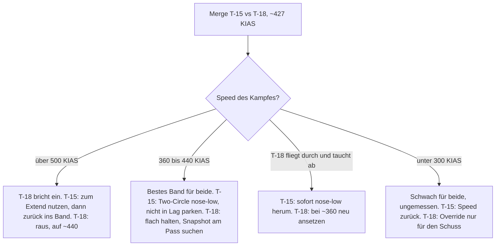

# T-15 vs. T-18

> Bei ~450 KIAS drehen beide gleich schnell, trotzdem gewinnt die T-15 laut Simulation mit fast jeder Strategie – am klarsten im Two-Circle nose-low bei ~360–440 KIAS. Die T-18 lebt von ihrer Nase und den Fehlern der T-15.

## Was entscheidet

| | T-15 | T-18 | Quelle |
|---|---|---|---|
| Sustained bei ~450 KIAS | 15,4 °/s (7,0 G) | 15,6 °/s (7,0 G) | gemessen |
| G bei gleicher Speed (≈355 KIAS) | **6,8 G** | 5,7 G | gemessen |
| Max Instant (10.000 ft) | **24 °/s** @ 360 | 22 °/s @ 385 | Diagramm |
| Min Radius (10.000 ft) | **1.644 ft** | 1.899 ft | Diagramm |
| Schub/Gewicht mit Nachbrenner (10.000 ft) | **1,65** | 1,35 | gemessen (Spieldaten 1,64 / 1,37) |
| Erster Turn aus 450 KIAS, nach 8 s | **146°**, danach ~286 KIAS | ≥ ~138° mit α ~26° (geschätzt); 127° voll gezogen, ~281 KIAS | gemessen / geschätzt |
| AoA-Limiter | ~24–25° | bis 35°, Nase ~10° weiter in der Kurve | gemessen |
| Hohe Speed (10.000 ft) | Top-Speed über 885 KIAS | Einbruch ab ~510 KIAS (≈ Mach 0,9), Top-Speed ~720 | Diagramm |
| 300 → 500 KIAS mit Nachbrenner | **~8,4 s** | ~12,3 s | gemessen |
| Rollrate (Vorgabe des Fly-by-Wire) | 325 °/s | **420 °/s** | Spieldaten, im Flug nicht gemessen |

Bei ~450 KIAS ist der Rate-Kampf ausgeglichen (im Diagramm liegt die T-18 zwischen ~400 und ~470 KIAS sogar minimal vorn). Klar vorn ist die T-15 **über ~500 KIAS** und **bei gleicher niedriger Speed**, wo sie mehr G zieht – und immer beim Schub. Die Waffe der T-18 ist ihre Nasenautorität für Snapshots. Alle Daten: [Flugzeugvergleich](/flugzeuge/vergleich).

**Ranked-Start** (*Replays*): 10.000 ft, ~427 KIAS (Mach 0,75), Head-on, 13.100 ft Abstand, ~1.300 ft seitlicher Versatz, Merge nach ~8 s, voller Tank. Vor dem ersten Pass fällt kein Schuss, danach sind Schüsse auf der Nase möglich: 14 % aller Schüsse fallen bei fast frontalem Aspect – genau das Feld der T-18.

## Wer dreht wo besser? (Diagramm, gemessen) {#wer-gewinnt-wo}

| Bereich / Flow | Vorteil im Rate-Vergleich | Warum |
|---|---|---|
| Unter ~280 KIAS, AoA-Override | **unbekannt** | Design-Vorteil der T-18 laut Entwickler – **Hypothese**, nicht gemessen. |
| ~300–380 KIAS | **T-15** | Sustained etwa gleich, aber mehr G, mehr Instant Rate, kleinerer Radius. |
| ~400–500 KIAS | **gleich** | Gleiche Sustained Rate. In Lag Pursuit fliegt die T-15 den größeren Kreis außen und fällt zurück. |
| Über ~500 KIAS | **T-15 klar** | Die T-18 bricht ab ~510 KIAS ein, die T-15 nicht. |
| ~20.000 ft | **T-15** | Mach 0,9 liegt dort schon bei ~450 KIAS – die T-18 bricht früher ein, die T-15 hält das flachste Plateau. |
| Beschleunigung, Vertikale | **T-15 klar** | ~1,4 vs ~0,95 × Gewicht Schubüberschuss; die T-18 hat den höchsten Grundwiderstand. |
| Nose-to-Nose-Pass, nah | **T-18** | Mit α bis 35° kommt ihre Nase weiter herum – Snapshot-Gefahr. |

## Diagramm gegen Simulation

Aus dem Rate-Vergleich folgte der alte Spielplan „T-15: kein Kreisen bei ~450, entweder schnell (> 500 KIAS) oder langsam“ und „T-18: Kampf langsam machen, One-Circle von unten“. Die [Simulation](/flugzeuge/simulation#t-15-gegen-t-18) deckt beides nicht:

- **Die T-15 gewinnt den Two-Circle bei 360–440 KIAS am klarsten** (nose-low +0,86, flach +0,79 gegen ein breites Feld), obwohl die Sustained Rate dort gleich ist. Sie zieht bei gleicher Speed mehr G, hat den kleineren Radius und holt mit viel mehr Schub ihre Energie zurück; die T-18 blutet mit ihrem hohen Widerstand aus.
- **Schnell kämpfen bringt nichts extra.** Über ~500 KIAS ist die T-15 zwar klar vorn, als Kampf-Speed aber schlechter als 360–440; 520 KIAS ist in jeder Paarung die schlechteste Kampf-Speed. Gegen die T-18 gewinnt die T-15 aber in jedem Band.
- **Der langsame One-Circle ist für beide schwach** (T-15 +0,49, T-18 −0,19). Bei 280 KIAS kostet hoher α so viel Energie, dass keiner aus dem Loch kommt.
- **Die T-18 hat keine Strategie, die ein breites Feld klar schlägt.** Am ehesten durchfliegen, abtauchen und bei ~360 kämpfen (+0,09) oder ein flacher Two-Circle bei ~440 (+0,08). Ihre 35° sind ~0,1 Spielwert wert.

Allgemein erklärt: [Diagramm und Simulation](/flugzeuge/vergleich#diagramm-und-simulation). Warum Menschen trotzdem anders erleben (siehe [Simulation und Praxis](/flugzeuge/simulation#simulation-und-praxis)): Bots zielen perfekt, schalten sofort von Lag auf den Schuss um und überschießen nicht. Eine T-15, die lange in Lag hängt oder mit viel Closure vor die Nase der T-18 rutscht, verliert gegen ihren Snapshot. Und das Ergebnis hängt stark an der Rollrate: Die Bots rollen alle gleich schnell; mit 270 statt 180 °/s ist die Paarung ausgeglichen, mit 120 °/s steht es +0,71. Laut Spieldaten rollt die T-15 langsamer als die T-18; real könnte der Vorsprung kleiner sein (*Hypothese*).

## Als T-15

### Plan

**Two-Circle, nose-low, Ziel-Speed ~400–420 KIAS** (Band 360–440). Am Pass zu ihr hin drehen und die Speed halten; ihre Energie geht schneller weg als deine. Pure oder Lag ist zweitrangig – entscheidend ist, dass du **nicht in Lag parkst**: Sobald die Nase kommt, schießen, statt außen weiterzukreisen.

- Fliegt sie durch und taucht ab (ihre beste Wahl): **sofort nose-low zu ihr herum**, nicht in den langsamen Kreis gehen ([3D-Simulator](/VFM_Wiki/sim/?szenario=t15-one-circle){target="_self"}).
- Hohe Speed (> 500 KIAS) ist dein Notausgang zum Extenden und Neuansetzen, nicht deine Kampf-Speed.
- Behalte immer ihre Nase im Blick.

### Merge

Im Two-Circle gewinnst du den ersten Turn knapp – aus 450 KIAS gemessen ~8° nach 8 s gegen eine sauber geflogene T-18, ~19°, wenn sie auf 35° überzieht ([Der erste Turn aus 450 KIAS](/grundlagen/neutral/der-merge#der-erste-turn-aus-450-kias-gemessen)). Im Modell aus dem echten Ranked-Start sieht es ähnlich aus (voll 131° gegen 123° mit α 26°, 108° mit α 35°). Voll gezogen bist du danach aber bei ~280 KIAS, also unter deinem Band: Hol die Speed zügig auf ~400 zurück, statt langsam und eng zu bleiben. Nach dem ersten Pass sind Schüsse auf der Nase erlaubt – erwarte an jedem weiteren Nose-to-Nose-Pass ihren Snapshot. Mehr: [Merge-Strategien für Ranked](/grundlagen/neutral/der-merge#merge-strategien-fur-ranked-start-450-kias), [One-Circle vs. Two-Circle](/grundlagen/neutral/one-two-circle).

### Was du vermeidest

- **Lange in Lag kreisen bei ~450 KIAS.** Gleiche Rate, du fliegst außen den größeren Kreis, und ihre Nase kommt weiter herum.
- **Overshoot vor ihre Nase.** Mit viel Closure auf eine langsame T-18 zu fliegen, endet in ihrem Snapshot. Lieber Lag und [High Yo-Yo](/grundlagen/offensiv/yo-yos), dann zum Schuss umschalten.
- **Phone Booth und Flat Scissors unter ~280 KIAS.** Ungetesteter Bereich, vermutlich ihrer, und in der Simulation für beide schwach. Siehe [Scissors](/grundlagen/neutral/scissors).
- **Extend aus der Defensive.** Aus gleicher Position hast du nach 5 s nur ~230 ft Abstand, nach 10 s ~900 ft (bei ~95 kt mehr Speed, gemessen). Extend nur, wenn ihre Nase weg zeigt. Siehe [Separation](/grundlagen/defensiv/separation).

**Raketen-Lobbys** (nicht Ranked, Ranked 1v1 ist Guns-only): Den ersten Fox-2-Schuss im Two-Circle hast du; im One-Circle kann sie dich unter der Mindestreichweite halten.

## Als T-18

### Plan

Die schwerste Paarung für dich, und die Simulation findet keine Strategie, die eine sauber fliegende T-15 klar schlägt. Was am meisten bringt:

1. **Speed halten statt langsam machen.** Bei ~400–470 KIAS drehst du so schnell wie sie (Diagramm). Am ehesten trägt ein **flacher Two-Circle bei ~440 KIAS** oder **durchfliegen, abtauchen und bei ~360 neu ansetzen**. Den langsamen One-Circle von unten (alter Spielplan) deckt die Simulation nicht.
2. **Deine Nase:** α bis 35° bringt sie ~10° weiter in die Kurve – für Snapshots an jedem Nose-to-Nose-Pass nach dem ersten.
3. **Ihre Fehler:** Overshoots, unnötige Vollzüge, langes Lag-Kreisen bei ~450 KIAS. Gegen Menschen ist das deine eigentliche Chance; die Bots machen diese Fehler nicht.

Ob du unter ~280 KIAS oder mit Override wirklich vorn bist, ist ungetestet.

### Merge

Pass eng; viel Turning Room gibt der Ranked-Start (~1.300 ft Versatz) ohnehin nicht her. Dreh den ersten Turn mit **α ~26°**, nicht mit 35°: Voll durchgezogen kommst du gemessen nach 8 s nur auf 127°, liegst ~19° hinten und verlierst ~170 KIAS ([Der erste Turn aus 450 KIAS](/grundlagen/neutral/der-merge#der-erste-turn-aus-450-kias-gemessen)). Das Modell bestätigt die Richtung (123° mit α 26° gegen 108° mit 35°). Danach Speed halten, nicht sehr langsam werden. Die 35° hebst du für den Snapshot auf. Mehr: [Merge-Strategien für Ranked](/grundlagen/neutral/der-merge#merge-strategien-fur-ranked-start-450-kias).

### Was du vermeidest

- **Den Kampf langsam machen.** Bei 280 KIAS verlierst du in der Simulation (−0,19); dein Widerstand frisst die Energie schneller, als du sie zurückholst.
- **Alles über ~480–510 KIAS.** Dort brichst du ein, sie nicht.
- **Ihr in die Vertikale folgen oder weglaufen.** Sie beschleunigt deutlich besser und ist viel schneller.
- **35° oder Override zum Kurven.** Über α ~26° ziehst du weniger G und verlierst extrem viel Energie. Override als Gewohnheit kostet in der Simulation viel (−0,76 statt −0,54); ein gezielter Snapshot kann trotzdem entscheiden ([3D-Simulator](/VFM_Wiki/sim/?szenario=t18-override){target="_self"}).

**Raketen-Lobbys:** Im One-Circle hältst du sie oft unter der Mindestreichweite; im Two-Circle gehört der erste Fox-2-Schuss ihr.

## Entscheidungshilfe

::: info IM SPIEL PRÜFEN
- **Rollrate im Flug:** Die Spieldaten nennen 325 (T-15) gegen 420 °/s (T-18). Die Simulation reagiert in dieser Paarung stark auf die Rollrate.
- **Unter ~280 KIAS und mit Override:** Hat die T-18 dort wirklich einen Vorteil? Nebeneinander bei ~250 KIAS gleichzeitig voll ziehen, Zeit für 180° und Speedverlust im Replay vergleichen.
- **Erster Turn der T-18 mit α ~26°:** Die ≥ ~138° sind geschätzt, eine eigene Messung fehlt.
- **Extend gegen Gun-Reichweite:** Ab welchem Abstand ist eine extendende T-15 aus der Gun-Reichweite einer folgenden T-18?
:::

::: info SIMULATION
Spielwert +0,39 für die T-15 (Spanne 0,00 bis +0,71, stark abhängig von der Rollrate). Die T-15 gewinnt mit fast jeder Strategie, am klarsten im Two-Circle nose-low bei 360–440 KIAS. Die T-18 hat keine Strategie, die ein breites Feld schlägt; am ehesten Durchfliegen und Abtauchen oder ein flacher Two-Circle bei ~440. Der langsame One-Circle ist für beide schwach. → [Simulation](/flugzeuge/simulation#t-15-gegen-t-18) Im 3D-Simulator: [Sofort nose-low herum](/VFM_Wiki/sim/?szenario=t15-one-circle){target="_self"}.
:::

::: tip MERKE
- T-15: Two-Circle nose-low bei ~400–420 KIAS. Nicht in Lag parken, nicht langsam, nicht schnell bleiben.
- T-15: kein Overshoot vor ihre Nase, kein Extend aus der Defensive. Ab dem zweiten Pass mit ihrem Snapshot rechnen.
- T-18: erster Turn mit α ~26°, danach Speed halten (~440), nicht langsam machen. 35° und Override nur für den Snapshot.
- T-18: Gegen eine saubere T-15 hilft keine Strategie klar. Deine Chance sind ihre Fehler.
- Der Low-Speed-Vorteil der T-18 ist eine Hypothese. Teste ihn, bevor du dein Spiel darauf baust.
:::

Weiter: [T-16 vs. T-18](/flugzeuge/matchups/t16-vs-t18)
