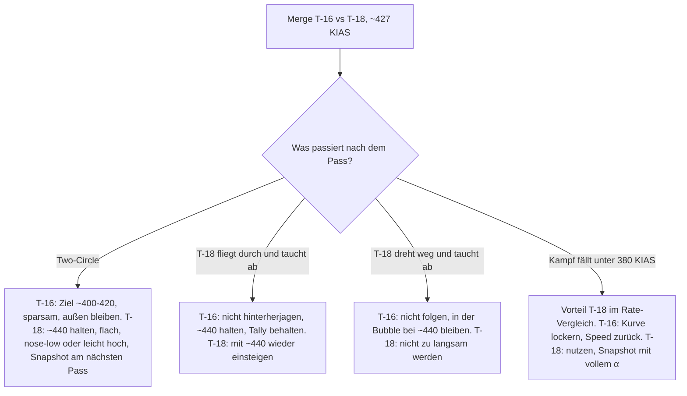

# T-16 vs. T-18

> Rate gegen Nase – und laut Simulation fast ausgeglichen. Im Two-Circle bei ~400–440 KIAS dreht die T-16 Kreis für Kreis Winkel heraus. Die T-18 hält mit Speed (~440 KIAS, nicht langsam), Durchfliegen und ihrer Nase dagegen. Wie knapp es ist, hängt an der Rollrate, die im Spiel noch nicht gemessen ist: Rollen die Jets langsamer als die Spieldaten vorgeben, liegt die T-16 klar vorn.

## Was entscheidet

| | T-16 | T-18 | Quelle |
|---|---|---|---|
| Sustained bei ~450 KIAS | **17,6 °/s** (7,9 G) | 15,6 °/s (7,0 G) | gemessen |
| Max Sustained (10.000 ft) | **18 °/s** @ 470 | 16 °/s @ 470 | Diagramm |
| Max Instant (10.000 ft) | 21 °/s @ 409 | **22 °/s** @ 385 | Diagramm |
| Min Radius (10.000 ft) | 2.099 ft | **1.899 ft** | Diagramm |
| Erster Turn aus 450 KIAS, nach 8 s | 141° sustained, hält ~450 KIAS | ≥ ~138° mit α ~26° (geschätzt); 127° voll gezogen, ~281 KIAS | gemessen / geschätzt |
| AoA-Limiter | ~23° | bis 35°, Nase ~10° weiter in der Kurve | gemessen |
| Speedverlust im Leerlauf bei ~450 KIAS | ~5 kt/s | ~9 kt/s | gemessen |
| 300 → 500 KIAS mit Nachbrenner | ~11,5 s | ~12,3 s | gemessen |
| Hohe Speed (10.000 ft) | Top-Speed ~835 KIAS | Einbruch ab ~510 KIAS (≈ Mach 0,9), Top-Speed ~720 | Diagramm |

Die T-16 hat den größten Sustained-Vorsprung aller Paarungen: 2 °/s, grob 30–40° pro Kreis – solange beide im Band fliegen. Die T-18 hat den ~10 % kleineren Radius, die niedrigere Corner Speed und die bessere Nase; mit dem höchsten Grundwiderstand aller Jets wird sie aber schnell langsam. Beide rollen laut Spieldaten gleich schnell (Vorgabe 420 °/s, im Flug nicht gemessen); damit rechnet die Simulation. Alle Daten: [Flugzeugvergleich](/flugzeuge/vergleich).

**Ranked-Start** (*Replays*): 10.000 ft, ~427 KIAS (Mach 0,75), Head-on, 13.100 ft Abstand, ~1.300 ft seitlicher Versatz, Merge nach ~8 s, voller Tank. Vor dem ersten Pass fällt kein Schuss; danach sind Schüsse auf der Nase möglich (14 % aller Schüsse bei fast frontalem Aspect).

## Wer dreht wo besser? (Diagramm, gemessen) {#wer-gewinnt-wo}

| Bereich / Flow | Vorteil im Rate-Vergleich | Warum |
|---|---|---|
| Unter ~380 KIAS | **T-18** | Kleinerer Radius, mehr Instant und Sustained Rate. Langsam ist die T-16 der schwächste Jet. |
| ~380–420 KIAS | Übergang | Die Sustained-Kurven kreuzen sich. |
| ~420–500 KIAS | **T-16** | +2 °/s Sustained, gemessen 17,6 vs 15,6 °/s. |
| Über ~480–510 KIAS | **T-16 klar** | Die T-18 bricht ab ~510 KIAS ein. |
| Erster Turn aus 450 KIAS | etwa gleich | T-18 mit α ~26° gleichauf; voll auf 35° gezogen verliert sie ~14°. |
| Nah, nose-to-nose | **T-18** | Mit α bis 35° kommt ihre Nase weiter herum – Snapshot-Gefahr. |
| Unter ~280 KIAS, AoA-Override | vermutlich T-18 | Design-Vorteil laut Entwickler – **Hypothese**, nicht gemessen. |
| Höhe | beide wollen tief | Auf ~20.000 ft schrumpft der Sustained-Vorsprung der T-16 auf 0–1 °/s; die T-18 bricht dort schon bei ~450 KIAS ein. |

## Diagramm gegen Simulation

Aus dem Rate-Vergleich folgte der alte Spielplan der T-18: „Kampf unter ~380 KIAS ziehen, One-Circle von unten“. Die [Simulation](/flugzeuge/simulation#t-16-gegen-t-18) bestätigt die T-16-Seite, widerspricht der T-18-Seite – und findet die Paarung trotzdem **fast ausgeglichen** (Spielwert +0,03 für die T-16):

- **T-16:** Two-Circle bei ~440 KIAS, leicht hoch (+0,55 gegen ein breites Feld), flach (+0,52) oder nose-low (+0,47); durchfliegen, abtauchen und mit ~440 zurückkommen geht auch (+0,49). Der bisherige Plan bleibt richtig, reicht gegen eine gute T-18 aber nur knapp.
- **T-18:** Ihre besten Familien liegen **alle bei ~440 KIAS**: durchfliegen, abtauchen und mit Speed wieder einsteigen (+0,35), Two-Circle leicht hoch (+0,30), Two-Circle flach oder nose-low (+0,16 bis +0,19). Der langsame One-Circle bei 280 KIAS verliert (−0,09).
- **Warum langsam nicht trägt:** Ihr Rate- und Radiusvorteil unter ~380 KIAS hilft nur, wenn die T-16 mit herunterkommt. Bleibt die T-16 außerhalb bei ~440 ([Bubble](/grundlagen/begriffe#bubble)), verliert die T-18 im langsamen Kreis Energie, die sie mit ihrem Widerstand kaum zurückholt. Bei ~440 bleibt sie schnell genug, um an jedem Pass etwas zu machen.
- **Rollrate:** Beide rollen laut Spieldaten mit 420 °/s; schnelles Rollen hilft dem Verteidiger und dem Snapshot, also der T-18. Mit drei Vierteln der Rollrate liegt die T-16 +0,36 vorn, in der Teilrechnung mit 180 °/s +0,65. Gemessen ist die Rollrate nicht. Nur 58 % der Kämpfe enden mit Abschuss (mit 180 °/s 81 %).
- **Ihre 35°** sind hier ~0,08 Spielwert wert. Override als Gewohnheit kostet viel (−0,38 statt −0,12).

Allgemein erklärt: [Diagramm und Simulation](/flugzeuge/vergleich#diagramm-und-simulation). Grenze: Bots zielen perfekt und verlassen die Bubble nicht aus Ungeduld. Gegen Menschen ist der Snapshot der T-18 mehr wert, als die Simulation zeigt (siehe [Simulation und Praxis](/flugzeuge/simulation#simulation-und-praxis)).

## Als T-16

### Plan

**Two-Circle, flach, nose-low oder leicht hoch, Ziel-Speed ~400–420 KIAS** (geflogen ~400–440), in Lag und sparsam geflogen. Nur nicht steil hoch. Im Turnier-Raster ist 440 die beste Stufe; die feinere Speed-Rechnung legt das Ziel auf ~400–420: Dort gibst du gegenüber deinem Sustained-Optimum (~460–470) nur ~0,2–0,3 °/s her und fliegst einen ~9 % kleineren Kreis. Mit sinkendem Fuel nicht schneller werden. Details: [T-16, Speed nach Fuel und Höhe](/flugzeuge/t16#speed-nach-fuel-und-hohe).

Die T-18 will dich nah und langsam – deine Aufgabe ist, **in der [Bubble](/grundlagen/begriffe#bubble)** zu bleiben: außerhalb ihres Kurvenkreises, ohne direkt auf sie zuzuziehen. Bis zum Abschuss vergehen im Median ~2,5 Minuten (*Replays*) – bei ~16–20 s pro Kreis nur ~7–9 Kreise. Ob dein Rate-Vorsprung in dieser Zeit reicht, ist laut Simulation offen (fast ausgeglichen, abhängig von der Rollrate). Rechne nicht mit einem sicheren Sieg; verschenken darfst du den Vorsprung jedenfalls nicht.

### Merge

Dreh den ersten Turn **sustained**: gemessen nach 8 s 141°, Speed bleibt bei ~450 KIAS. Eine T-18 mit α ~26° ist etwa gleichauf; zieht sie voll durch, liegt sie ~14° hinten und ist bei ~281 KIAS ([Der erste Turn aus 450 KIAS](/grundlagen/neutral/der-merge#der-erste-turn-aus-450-kias-gemessen)). Im Modell aus dem echten Ranked-Start bringt dir voller Zug ~12° mehr (126° gegen 114°), kostet aber ~80 KIAS und wirft dich unter dein Band ([3D-Simulator: Erster Turn](/VFM_Wiki/sim/?szenario=erster-turn){target="_self"}, dort gegen die T-15). Danach Two-Circle im Band. Fliegt sie One-Circle oder taucht nose-low ab, geh nicht mit – Speed halten, außen bleiben, am nächsten Pass Two-Circle. Fliegt sie durch und taucht ab (laut Simulation ihre beste Wahl), jag ihr nicht hinterher: ~440 halten, Tally behalten und den nächsten Pass mit Speed nehmen. Mehr: [Merge-Strategien für Ranked](/grundlagen/neutral/der-merge#merge-strategien-fur-ranked-start-450-kias), [One-Circle vs. Two-Circle](/grundlagen/neutral/one-two-circle).

### Was du vermeidest

- **Langsam werden und One-Circle.** Unter ~380 KIAS ist jede Kennzahl gegen dich.
- **Die Bubble verlassen.** Mit viel Closure in ihren Kreis hinein landest du vor ihrer Nase. Dann reicht ihr ein kurzer Zug auf 35° für den [Snapshot](/grundlagen/begriffe#snapshot). Lieber Lag und [High Yo-Yo](/grundlagen/offensiv/yo-yos); schieß nur, wenn du danach nicht vor ihre Nase rutschst. Das ist der menschliche Fehler, den die Simulation nicht abbildet.
- **Steil hoch.** In der Simulation halbiert steil hoch auch gegen die T-18 deinen Vorteil (+0,26 statt +0,55 gegen ein breites Feld). Leicht hoch (~25°) bei ~440 ist dagegen deine beste Familie.
- **Flat Scissors.** Die gewinnt, wer schneller langsam wird – sie. Siehe [Scissors](/grundlagen/neutral/scissors).
- **Gerader Extend aus der Defensive.** Bis ~500 KIAS beschleunigt ihr fast gleich. Erst darüber fällt sie zurück. Verteidige dich zuerst mit [Guns Defense](/grundlagen/defensiv/guns-defense).

**Raketen-Lobbys** (nicht Ranked, Ranked 1v1 ist Guns-only): Im ausgeflogenen Two-Circle bist du der schneller drehende Jet, der Fox-2-Schuss gehört eher dir; im One-Circle hält sie dich unter der Mindestreichweite.

## Als T-18

### Plan

**Speed bei ~440 KIAS halten** – alle deine besten Familien liegen dort. Laut Simulation hast du drei gute Optionen:

- **Durchfliegen, abtauchen und mit ~440 wieder einsteigen** (+0,35 gegen ein breites Feld, deine beste).
- **Two-Circle leicht hoch (~25°) bei ~440** (+0,30).
- **Two-Circle flach oder nose-low bei ~440** (+0,16 bis +0,19).

Damit ist die Paarung fast ausgeglichen – **wenn** die Jets im Spiel so schnell rollen, wie die Spieldaten vorgeben. Rollen sie langsamer, liegt die T-16 klar vorn (siehe [Diagramm gegen Simulation](#diagramm-gegen-simulation)). Den Kampf bewusst langsam zu machen (alter Spielplan), verliert laut Simulation, weil eine disziplinierte T-16 nicht mitkommt.

Deine echten Chancen gegen Menschen:

1. **Ihr Fehler, die Bubble zu verlassen.** Rutscht sie mit Closure vor deine Nase, ist das dein Snapshot.
2. **Ihr Fehler, mit dir langsam zu werden.** Unter ~380 KIAS hast du Radius, Instant und Sustained Rate. Folgt sie dir dorthin, nutze es.
3. **Jeder Nose-to-Nose-Pass nach dem ersten:** voll auf 35° für den Schuss, danach sofort nachlassen.

### Merge

Drehst du am Merge, dann den ersten Turn mit **α ~26°**, nicht mit 35°: Dann seid ihr etwa gleichauf. Voll durchgezogen kommst du gemessen nur auf 127°, liegst ~14° hinten und verlierst ~170 KIAS ([Der erste Turn aus 450 KIAS](/grundlagen/neutral/der-merge#der-erste-turn-aus-450-kias-gemessen)). Das Modell aus dem Ranked-Start bestätigt die Richtung (123° mit α 26° bei ~330 KIAS, 108° mit 35° bei ~282 KIAS). Danach zu ihr hin (flach, nose-low oder leicht hoch) und die Speed Richtung ~440 halten, statt sie abzubauen. Oder du fliegst durch, tauchst ab und steigst mit ~440 wieder ein – laut Simulation sogar deine beste Wahl. Mehr: [Merge-Strategien für Ranked](/grundlagen/neutral/der-merge#merge-strategien-fur-ranked-start-450-kias).

### Was du vermeidest

- **Langsamer One-Circle aus Prinzip.** Bei 280 KIAS kommst du aus dem Energieloch nicht heraus, und eine T-16 in der Bubble wartet einfach. Wegdrehen ist in der Simulation deine schlechteste Drehrichtung.
- **Alles über ~480–510 KIAS.** Deine Energiehaltung bricht ein.
- **Steil hoch.** Im Mittel deine schlechteste Ebene (Simulation); leicht hoch bei ~440 ist dagegen eine gute Option.
- **Ihr bei Speed hinterherjagen.** Extendet sie, lass sie gehen, behalte Tally und bereite den nächsten Merge vor.
- **35° oder Override zum Kurven.** Über α ~26° ziehst du weniger G und verlierst extrem viel Energie. Nur für einen Schuss oder gegen einen Schuss auf dich.

**Raketen-Lobbys:** Im One-Circle hältst du sie oft unter der Mindestreichweite, im Two-Circle gehört der Fox-2-Schuss eher ihr.

## Entscheidungshilfe

::: info IM SPIEL PRÜFEN
- **Rollrate im Flug:** Die Spieldaten nennen für beide 420 °/s als Vorgabe. Ob die Jets das erreichen, entscheidet laut Simulation, ob die Paarung ausgeglichen ist oder die T-16 klar vorn liegt ([Messflug M6](/grundlagen/uebungen#b2-eigenen-jet-vermessen)).
- **Erster Turn der T-18 mit α ~26°:** Die ≥ ~138° sind geschätzt, eine eigene Messung fehlt.
- **Unter ~280 KIAS und mit Override:** Wie groß ist der Vorteil der T-18 dort wirklich?
- **Gun-Reichweite:** Wie weit muss die T-16 außerhalb ihres Kreises bleiben, um vor dem Snapshot sicher zu sein?
:::

::: info SIMULATION
Spielwert +0,03 für die T-16, praktisch ausgeglichen (Rollraten aus den Spieldaten). Rollen die Jets langsamer, liegt die T-16 klar vorn: +0,36 mit drei Vierteln der Rollrate, +0,65 in der Teilrechnung mit 180 °/s. Beste T-16-Familien: Two-Circle bei ~440 KIAS, leicht hoch, flach oder nose-low. Beste T-18-Familien: durchfliegen, abtauchen und mit ~440 wieder einsteigen, oder Two-Circle leicht hoch bei ~440 – nicht der langsame Kreis. → [Simulation](/flugzeuge/simulation#t-16-gegen-t-18) Im 3D-Simulator: [Two-Circle bei 440 KIAS: knapp (5 von 9 für die T-16)](/VFM_Wiki/sim/?szenario=t16-two-circle){target="_self"}, [One-Circle: in der Bubble bleiben](/VFM_Wiki/sim/?szenario=t16-bubble){target="_self"}.
:::

::: tip MERKE
- T-16: erster Turn sustained, dann Two-Circle bei ~400–440 KIAS, flach, nose-low oder leicht hoch – nicht steil hoch. In der Bubble bleiben, nie mit ihr langsam werden, keine Flat Scissors.
- T-18: ~440 halten. Durchfliegen und abtauchen oder Two-Circle (erster Turn mit α ~26°) – nicht langsam machen. 35° nur für den Snapshot am Pass.
- Laut Simulation fast ausgeglichen; rollen die Jets langsamer als die Spieldaten vorgeben, liegt die T-16 klar vorn. Die Rollrate ist nicht gemessen.
- Unter ~380 KIAS dreht die T-18 besser (Diagramm), aber nur, wenn die T-16 mitkommt (Simulation).
- 2 °/s Sustained-Vorsprung sind ~30–40° pro Kreis. Die T-18 lebt davon, dass die T-16 die Bubble verlässt.
:::

Weiter: [Team-Taktik](/flugzeuge/team)
