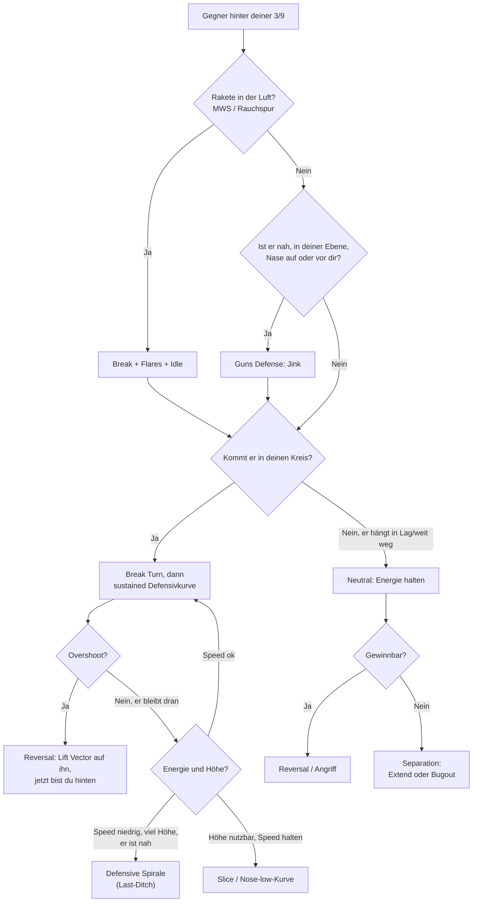

# Defensive Manöver – Prioritäten und Entscheidungslogik

> Er ist hinter dir. Erst überleben, dann neutralisieren, dann entweder umdrehen oder raus.

Defensiv heißt: Der Gegner steht hinter deiner 3/9-Linie und bestimmt das Tempo. Du gewinnst das nicht in einem Zug, sondern arbeitest eine Prioritätenliste ab. Jede Stufe hat nur ein Ziel: die nächste zu erreichen.

## Die Prioritäten

1. **Bedrohung sehen.** Kopf drehen, RWR und MWS beachten ([RWR & MWS](/avionik/rwr)).
2. **Den Schuss schlagen.** Kanone in Lösung: [Guns Defense](/grundlagen/defensiv/guns-defense). Rakete (nur in Custom-Lobbys): [Break + Flares + Idle](/grundlagen/defensiv/break-turn#raketenabwehr-kurzfassung). Alles andere wartet.
3. **Sicht halten.** Ohne Sicht reagierst du nur noch auf Vermutungen.
4. **Eintritt in deinen Kurvenkreis verweigern.** Mit [Break Turn](/grundlagen/defensiv/break-turn) und Defensivkurve hältst du seine AA hoch.
5. **Overshoot erzwingen.** Siehe [Overshoot](/grundlagen/offensiv/overshoot).
6. **Neutralisieren:** keiner hat mehr einen Vorteil.
7. **Umkehren oder separieren.** Reversal, Schere, Vertikale – oder kontrolliert raus: [Separation](/grundlagen/defensiv/separation).

::: warning DIE REIHENFOLGE ZÄHLT
Wer gegen eine anfliegende Rakete an seine Energie denkt, ist tot. Wer nach dem überlebten Schuss weiter Max-G zieht, verliert die Energie für die nächste Stufe. Immer die oberste offene Priorität zuerst.
:::

## Entscheidungslogik

## Die Werkzeuge

| Situation | Werkzeug | Kurz |
|---|---|---|
| Er kommt rein, droht in Schussposition | [Break Turn](/grundlagen/defensiv/break-turn) | Lift Vector auf ihn, max Instant Rate nahe Corner Speed, dann Defensivkurve |
| Rakete in der Luft | [Raketenabwehr](/grundlagen/defensiv/break-turn#raketenabwehr-kurzfassung) | Break + Flares + Idle, Details: [Gegenmaßnahmen](/avionik/gegenmassnahmen) |
| Er ist in Kanonen-Lösung | [Guns Defense](/grundlagen/defensiv/guns-defense) | Unload, rollen, max G aus seiner Ebene, wiederholen |
| Rate nötig, Speed halten, Höhe da | [Slice Turn](/grundlagen/defensiv/slice-turn) | Überbankt, Nase unter Horizont, nahe max G |
| Langsam, er klebt hinter dir, viel Höhe | [Defensive Spirale](/grundlagen/defensiv/spirale) | Steil nose-low, geladen, langsam |
| Kein Sieg möglich oder Unterzahl | [Separation](/grundlagen/defensiv/separation) | Unload, volle Leistung, raus aus seiner WEZ |
| Er hat überschossen, ihr seid nah nebeneinander | [Scissors](/grundlagen/neutral/scissors) | Gezielt einsetzen oder vermeiden |

## VFM-Hinweise

- **Im Ranked ist die Bedrohung die Kanone.** In 71 eigenen Replays: 63 Abschüsse mit der Kanone, 9 Abstürze, keine Rakete (*Replays*). Stufe 2 heißt dort immer [Guns Defense](/grundlagen/defensiv/guns-defense) – und ~12 % der Runden enden am Boden: Nose-low-Abwehr nie ohne Blick auf das [Hard Deck](/grundlagen/golden-rules#hard-deck-2-000-ft).
- **Nicht langsam werden.** Voller Zug kostet im Spiel sehr viel Energie, weil der Widerstand mit dem Anstellwinkel steil steigt (*Spieldaten*). Laut Simulation gewinnen alle drei Jets bei ~440 KIAS am meisten (360 geht, ist aber schwächer); wer auf ~280 KIAS absinkt, kommt aus dem Loch kaum heraus. Nach dem Break also zurück ins Band.
- **Jet-Wahl prägt die Defensive.** Die [T-15](/flugzeuge/t15) bricht am härtesten (beste Instant Rate, kleinster Radius), verliert dabei aber am meisten Energie und rollt laut Spieldaten am langsamsten. Die [T-16](/flugzeuge/t16) verteidigt am besten, indem sie ihre Speed bei ~400–440 KIAS hält. Die [T-18](/flugzeuge/t18) zieht zum Kurven α ~26°, nicht 35°. Die alte Empfehlung „T-18: Kampf langsam machen“ deckt die Simulation nicht; auch für sie ist ~440 KIAS am besten (Two-Circle oder durchfliegen, abtauchen und mit Speed zurückkommen). Daten: [Flugzeugvergleich](/flugzeuge/vergleich), [Simulation](/flugzeuge/simulation).

## Ranked 1v1: Überleben reicht nicht

Bei Zeitablauf gewinnt der Verfolger (Rundenzeit 8 Minuten). Die Simulation zeigt, wie hart das ist: Sitzt ein gleichwertiger Gegner **~2.700 ft an deiner Six**, verweigern die Bots meist den Schuss über die ganze Runde (7 von 9 Varianten bleiben offen) – **den Kampf umzudrehen gelingt ihnen aber kaum**. Am Ende gewinnt der Verfolger.

- **Komm nicht in diese Lage.** Der Ranked-Start ist neutral (Head-on); defensiv wirst du durch verlorene erste Turns. Der beste Schutz ist ein guter [Merge](/grundlagen/neutral/der-merge).
- **Bist du drin, arbeite auf seinen Fehler hin:** Schuss verweigern, Energie im Band halten, und den [Overshoot](/grundlagen/offensiv/overshoot) sofort nutzen, wenn er kommt. Menschen machen diese Fehler eher als Bots, die perfekt zielen und alles sehen.
- **Plane rechtzeitig.** Separation ist im Ranked nur ein Zwischenschritt ([Separation im Ranked](/grundlagen/defensiv/separation#vfm-separation-im-ranked-1v1-hat-einen-preis)).

**Im 3D-Simulator:** [Defensiv: Bandit an deiner Six](/VFM_Wiki/sim/?szenario=defensiv){target="_self"} – Break, zurück ins Band, Schuss verweigern; der helle Geist bleibt bei ~360 KIAS nose-low, unter dem Band der T-16, und wird öfter getroffen.

::: tip MERKE
- Sehen, Schuss schlagen, Sicht halten, Eintritt verweigern, Overshoot erzwingen, neutralisieren, umdrehen oder raus.
- Immer die oberste offene Priorität zuerst.
- Max G nur, solange eine Bedrohung da ist. Danach zurück ins Band ~380–440 KIAS.
- Ranked: Den Schuss verweigern kannst du lange, umdrehen nur mit seinem Fehler. Bei Zeitablauf gewinnt der Verfolger.
- Der Overshoot des Angreifers ist dein Weg zurück – aber nicht durch Bremsen in seine Tracking-Lösung hinein.
:::

Weiter: [Break Turn](/grundlagen/defensiv/break-turn)
