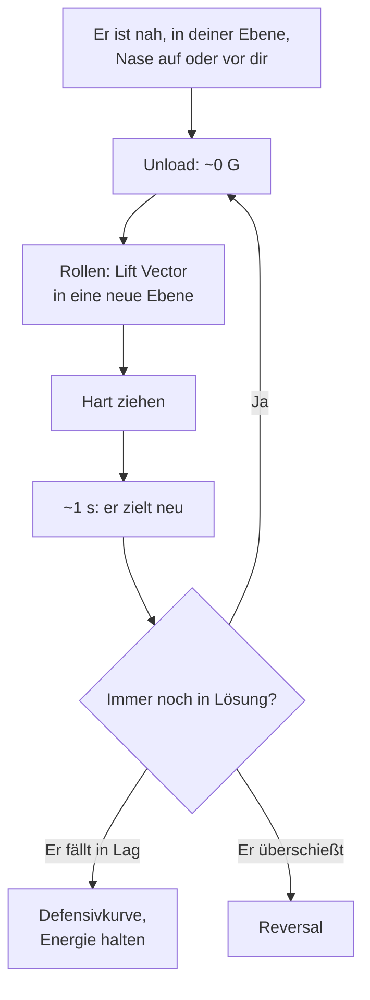

# Guns Defense: der Jink

> Er sitzt mit der Kanone hinter dir und hat (fast) eine Lösung. Jetzt zählt nur eins: nicht dort sein, wo die Geschosse ankommen.

Ein Kanonenschuss trifft, weil der Angreifer vorhersagt, wo du am Ende der Geschossflugzeit sein wirst. Das geht nur, wenn du **in einer Ebene** und **vorhersehbar** kurvst. Der Jink zerstört diese Vorhersage: Du wechselst deine Bewegungsebene schneller, als er den Vorhalt nachführen kann.

Im Ranked 1v1 ist das die Abwehr, auf die es ankommt: In 71 eigenen Replays gab es 63 Abschüsse mit der Kanone, 9 Abstürze und keine Rakete (*Replays*).

## Wie viel Zeit du hast

Die Geschosse verlassen die Kanone mit 1.030 m/s plus seiner eigenen Speed (*Spieldaten*). Daraus folgt, wie lange sie zu dir unterwegs sind – und wie weit dich ein Jink in dieser Zeit versetzt (grob gerechnet: Lastwechsel um ~6 G, ohne Roll- und Lastaufbauzeit, Streuung nicht berücksichtigt):

| Seine Entfernung | Geschossflugzeit | Dein Versatz durch den Jink in dieser Zeit |
|---|---|---|
| 1.000 ft | ~0,25 s | ~2 m |
| 1.500 ft | ~0,4 s | ~5 m |
| 3.000 ft | ~0,75 s | ~17 m |

**Die Lehre:** Auf 3.000 ft reicht ein Jink nach seinem Abzug noch, um aus dem Geschossstrom zu kommen. Auf 1.000 ft bewegst du dich in der Flugzeit kaum: Dort musst du **schon in der neuen Ebene sein, bevor er abdrückt**. Je näher er kommt, desto früher und ununterbrochener jinkst du.

## Wann

Wenn er **nah genug** für die Kanone ist (Richtwert: unter ~3.000 ft), **in deiner Ebene** fliegt und seine Nase **auf oder vor dir** steht (Pure oder Lead), ist er in Tracking-Lösung oder kurz davor. Das ist der Moment für den Jink. Hängt er weit in Lag oder außerhalb deiner Ebene, ist der Jink unnötig teuer: Dann gelten [Break Turn](/grundlagen/defensiv/break-turn) und Defensivkurve.

## Ausführung

1. **Unload** auf etwa 0 bis 0,5 G. Deine Flugbahn verlässt sofort die Kurve, die er vorausberechnet. Das Entladen ist der schnellste Teil des Jinks – die volle G baut sich danach erst über Sekunden auf (gemessen 2–3 s bis Höchst-G).
2. **Rollen**: Lift Vector in eine **deutlich neue Richtung** aus seiner Ebene, z. B. von einer Linkskurve in eine nose-low Rechtskurve.
3. **Hart ziehen** in die neue Ebene (T-18: bis α ~26°, nicht an den 35°-Anschlag).
4. **Nach ~1 s wiederholen** (Richtwert: seine Zeit zum Nachrollen und Nachzielen plus die Geschossflugzeit). Bis dahin hat er sich auf deine neue Ebene eingestellt – genau dann bist du wieder woanders.
5. **Erkennen, wann es vorbei ist:** Er fällt in Lag oder [überschießt](/grundlagen/offensiv/overshoot).

**Worauf es ankommt:**

- **Unvorhersehbar:** kein Rhythmus, wechselnde Richtung, Querlage und Anteil nach oben oder unten.
- **Aus der Ebene, nicht in der Ebene:** Härter in derselben Kurve ziehen kostet ihn nur etwas mehr Vorhalt. Erst der Ebenenwechsel zwingt ihn, neu zu rollen und zu zielen.
- **Energie:** Der Widerstand steigt mit dem Anstellwinkel steil an – bei α 25° hat der Flügel ein Vielfaches des Widerstands bei α 0 (*Spieldaten*). Jeder Max-G-Pull kostet deshalb viel Speed, bei der T-15 am meisten. Zieh nur so hart, wie der Ebenenwechsel braucht. Nose-low-Jinks halten Speed besser, kosten aber Höhe.

::: danger NICHT VERLANGSAMEN, WÄHREND ER TRACKT
Gas raus, damit er vorbeifliegt, hilft ihm, solange er in Lösung sitzt: Du wirst langsamer und berechenbarer, er braucht weniger Vorhalt. Bremsen, um einen Overshoot zu erzwingen, ist nur eine Option, wenn er **nicht** in Lösung ist und mit großer Closure kommt – und auch dann ein bewusstes Risiko.
:::

## Head-on Guns

Im Ranked fällt vor dem ersten Pass kein Schuss (in den Replays 0 von 7.314). Danach schon: **14 % aller Schüsse** kamen bei fast frontalem Aspect (*Replays*). An jedem späteren Pass Nase an Nase gilt deshalb dasselbe Prinzip: nicht geradeaus auf ihn zufliegen, sondern dich vorher aus seiner Ebene versetzen. Siehe [Der Merge](/grundlagen/neutral/der-merge) und [Schusslösung](/grundlagen/offensiv/schussloesung#head-on-guns).

## Typische Fehler

- **Links-rechts-Wackeln in derselben Ebene.** Verschiebt nur seinen Vorhalt ein wenig.
- **Rhythmisch jinken.** Dann schießt er auf deine nächste Bewegung.
- **Zu spät jinken, wenn er schon nah ist.** Auf 1.000 ft sind die Geschosse in einer Viertelsekunde da.
- **Unter Last rollen.** Erst entladen, dann rollen, dann ziehen.
- **Nach dem Jink nicht umschalten.** Ist die Lösung weg, zurück in die Defensivkurve oder in den Reversal.
- **Den Boden vergessen.** ~12 % der Ranked-Runden in den Replays endeten mit einem Absturz. Nose-low-Jinks in Bodennähe enden im Gelände.

## VFM-Hinweise

- **Rollrate:** Laut Spieldaten gibt das Fly-by-Wire bis 325 °/s (T-15) bzw. 420 °/s (T-16, T-18) vor; im Flug ist das nicht gemessen. Eine halbe Rolle dauert damit idealisiert ~0,55 s bzw. ~0,43 s. **Die T-15 rollt am langsamsten:** Als Verteidiger braucht sie für den Ebenenwechsel etwas länger, als Angreifer zielt sie etwas langsamer nach. Auf kurze Distanz ist das dieselbe Größenordnung wie die Geschossflugzeit. Die [Simulation](/flugzeuge/simulation#die-rollrate-entscheidet-mit) rechnet inzwischen mit diesen Werten: Schnelleres Rollen stärkt dort die Verteidigung, und weniger Kämpfe enden mit Abschuss.
- **Greyout/Blackout** ist simuliert. Wiederholte Max-G-Pulls können dir die Sicht nehmen, und Sicht ist hier alles ([G-Awareness](/grundlagen/golden-rules#g-awareness-greyout-und-blackout)).
- **AoA-Override** als allerletzte Option: versetzt die Nase schlagartig, kostet aber extrem Energie. Danach bist du langsam und hast kaum Optionen.

::: info IM SPIEL PRÜFEN
- Rollrate im Flug: Erreichen die Jets die Vorgabe aus den Spieldaten, und wie schnell kommst du entladen von einer Kurve in die Gegenrichtung?
- Streuung der Kanone: Wie breit ist der Geschossstrom auf 1.000 und 3.000 ft?
:::

::: tip MERKE
- Jink, wenn er nah, in deiner Ebene und mit der Nase auf oder vor dir ist.
- Unload, rollen in eine neue Ebene, hart ziehen, nach ~1 s wiederholen.
- Geschossflugzeit: ~0,25 s auf 1.000 ft, ~0,75 s auf 3.000 ft. Je näher er ist, desto früher musst du schon woanders sein.
- Ebene wechseln, nicht nur härter ziehen. Kein Rhythmus.
- Nicht bremsen, solange er in Tracking-Lösung ist.
- Lösung weg: sofort zurück in die Defensivkurve oder Reversal.
:::

Weiter: [Slice Turn](/grundlagen/defensiv/slice-turn)
