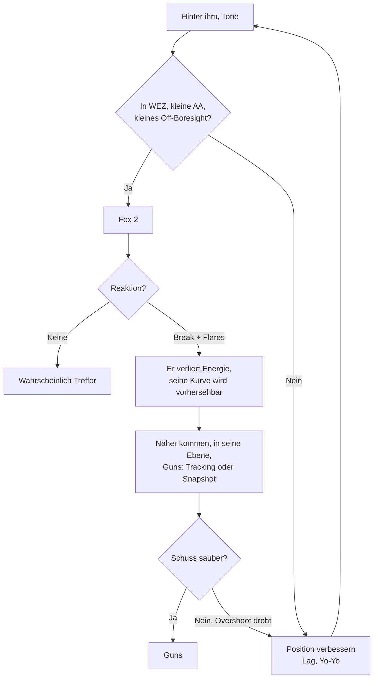

# Schusslösung: Guns und Fox 2

> Position ist nur die Vorarbeit. Hier geht es darum, wann und wie du triffst.

VFM hat zwei Waffen: die **Bordkanone** (Guns) und **einen Typ IR-Rakete** (Brevity beim Abschuss: **Fox 2**). Keine Radar-Raketen, kein Chaff. Was erlaubt ist, legt der Host fest. **Ranked 1v1 ist Guns-only:** In 71 eigenen Replays gab es 63 Abschüsse mit der Kanone, 9 Abstürze und keine Rakete (*Replays*). Bedienung und Anzeigen: [Waffen](/avionik/waffen) und [HUD](/avionik/hud).

## Grundregel: in seiner Ebene

Der einfachste Schuss entsteht, wenn du **in seiner [Bewegungsebene](/grundlagen/geometrie#bewegungsebene-plane-of-motion)** fliegst: Dein Lift Vector liegt auf ihm, deine Kurve in derselben Ebene wie seine. Dann bewegt er sich relativ zu dir nur entlang deiner Nase, nicht seitlich, und du musst nur noch den richtigen Vorhalt ziehen. Außerhalb seiner Ebene korrigierst du in zwei Richtungen gleichzeitig, und die Geschosse laufen seitlich vorbei.

## Guns

### Die Kanone in Zahlen

| Kanone (alle Jets) | Wert | Quelle |
|---|---|---|
| Mündungsgeschwindigkeit | 1.030 m/s (~3.380 ft/s), relativ zu deinem Jet | *Spieldaten*, in Replays bestätigt |
| Kadenz | 6.000 Schuss/min = 100 pro Sekunde | *Spieldaten* |
| Schaden | 26 je Treffer | *Spieldaten* |
| Geschossflug | ~6 s und ~4,5 km, am Ende noch ~600 m/s | *Replays* |
| Flugzeit bis 3.000 ft (~900 m) | ~0,75 s | *Spieldaten*, *Replays* |

Weil die Mündungsgeschwindigkeit zu deiner eigenen Speed dazukommt, sind die Geschosse auf kurze Distanz mit gut 1.200 m/s unterwegs. Wie viele Treffer ein Jet verträgt und wie stark die Kanone streut, ist nicht ausgewertet.

### Vorhalt: Drehrate mal Flugzeit

Während die Geschosse fliegen, dreht er weiter. Sitzt du in seiner Ebene und gehst seine Kurve mit, brauchst du grob **Vorhalt ≈ seine Drehrate × Geschossflugzeit**. Gerechnet für eine typische Kurve mit 15 °/s (sustained bei ~450 KIAS, gemessen 15–18 °/s):

| Entfernung | Flugzeit (gerechnet) | Vorhalt bei 15 °/s |
|---|---|---|
| 1.000 ft (~300 m) | ~0,25 s | ~4° |
| 1.500 ft (~450 m) | ~0,4 s | ~6° |
| 3.000 ft (~900 m) | ~0,75 s | ~11° |

Doppelte Entfernung heißt also doppelter Vorhalt – und doppelt so viel Zeit, in der er seine Kurve ändern kann, bevor die Geschosse ankommen. Der Funnel rechnet das für dich, aber nur, wenn er die Entfernung kennt und er seine Kurve beibehält.

### Das Visier: Funnel

Alle drei Jets haben ein EEGS-artiges Kanonenvisier, den **Funnel**: zwei Linien, die zeigen, wo dein Geschossstrom liegt, wenn du deine Kurve beibehältst. Wo der Funnel so breit ist wie die Spannweite des Gegners, stimmt die Entfernung. Mit Radar-Lock kennt das Visier die Entfernung; ohne Lock rechnet es mit einer durchschnittlichen Spannweite, also nur näherungsweise. Das **Gun-Boresight-Kreuz** zeigt, wohin die Kanone ohne Vorhalt zeigt. Die Academy hat ein Gunsight-Tutorial.

### Tracking Shot und Snapshot

| | Tracking Shot | Snapshot |
|---|---|---|
| Wann | Hinter ihm, in seiner Ebene, kleine AA, du gehst seine Kurve mit | Hohe AA bzw. Sichtlinienrate, du kannst den Funnel nicht auf ihm halten |
| Wie | Funnel auf ihn, Flächen füllen den Funnel, kurze Stöße, nachkorrigieren | Funnel in seiner Ebene vor ihn legen, kurz **bevor** er hineinfliegt feuern |
| Erkennen | Funnel **bleibt** auf ihm | Funnel läuft **durch** ihn |
| Preis | – | Geringere Trefferchance; der Lead treibt dich Richtung [Overshoot](/grundlagen/offensiv/overshoot) |

Der Schusstyp hängt vom **Winkel und der Relativbewegung** ab, nicht von der Entfernung. Ein Snapshot ist eine Gelegenheit, keine Taktik.

### Reichweite und Munition

- **Weit fliegen heißt nicht weit treffen.** Die Geschosse kommen ~4,5 km weit, aber auf 6.000 ft fliegen sie schon mindestens ~1,5 s (gerechnet) – gegen einen kurvenden Gegner reine Hoffnung. Richtwert aus dem realen BFM, mit den Flugzeiten oben gut begründet: erst unter etwa 3.000 ft wirklich aussichtsreich, besser näher. Eine offizielle effektive Reichweite gibt es nicht.
- **Kurze Stöße.** Bei 100 Schuss pro Sekunde sind schon eine halbe Sekunde Feuer 50 Geschosse. Munition ist endlich, es gibt kein Nachladen, und mit leeren Stores startet ein Selbstzerstörungs-Countdown.

### Head-on Guns

**Ranked:** Vor dem ersten Pass fällt kein Schuss – in den Replays 0 von 7.314 Schüssen (*Replays*; Einstellung **Merge Safety**). Danach ist die Nase frei: **14 % aller Schüsse** fielen bei fast frontalem Aspect (160–180°), also an späteren Pässen Nase an Nase, typisch im [One-Circle](/grundlagen/neutral/one-two-circle). In Custom-Lobbys können Frontalschüsse erlaubt oder verboten sein; prüf vor dem Match, was gilt.

Ein Frontalschuss ist ein Snapshot mit sehr hoher Closure: Bei ~1.000 kt Annäherung bist du aus 3.000 ft in unter 2 s am Pass. Kurzer Stoß, dann aus seiner Schusslinie. Kommt er dir an einem Pass schussbereit entgegen, versetz dich vorher aus seiner Ebene. Siehe [Der Merge](/grundlagen/neutral/der-merge) und [Guns Defense](/grundlagen/defensiv/guns-defense).

## Fox 2 (IR-Rakete)

Nur in Custom-Lobbys mit Raketen relevant; im Ranked 1v1 gibt es keine.

**Tone:** Der Suchkopf muss das Ziel erfassen, bevor du schießt; üblich ist ein Ton, der bei Aufschaltung lauter bzw. höher wird. Kein Tone, kein Schuss.

**WEZ der Rakete** ([Gun vs. Fox 2](/grundlagen/geometrie#wez-gun-vs-fox-2)):

- **Minimalreichweite:** Die Rakete braucht Strecke zum Eindrehen. Ein enger [One-Circle](/grundlagen/neutral/one-two-circle) kann dich darunter bringen.
- **Maximalreichweite:** Hängt stark von Aspect, Höhe und Speeds ab; gegen ein wegfliegendes Ziel deutlich kürzer.
- **Off-Boresight:** Je weiter neben deiner Nase, desto mehr muss die Rakete kurven und desto mehr Energie verliert sie.
- **Aspect:** Klassische IR-Raketen brauchen einen Schuss von hinten. Die Community berichtet, dass sie in VFM auch frontal trifft (nicht bestätigt).

**Der gute Fox-2-Schuss:** Gegner vor dir, kleine AA, nicht in einer harten Kurve, kleines Off-Boresight, mitten in der WEZ, und er hat keine Flares mehr oder sieht dich nicht.

## Schusslogik: Fox 2 zwingt, Guns tötet

Gegen eine Rakete muss er reagieren: brechen, Flares, Gas raus. Das kostet ihn Energie und Position – dann kommst du näher und holst dir den Gun-Schuss.

- **Nicht alle Raketen auf einmal.** Ein zweiter Schuss in seinen Flare-Strom ist meist verschwendet. Warte, bis er aus dem Break kommt.
- Wer früh alles verschießt, hat später nur noch Guns.

Im **Ranked 1v1** (Guns-only) zählen nur Position, Ebene und Funnel. Siehe [Spielmodi](/einstieg/spielmodi).

## Die Jets

- **Kanone:** bei allen drei gleich (*Spieldaten*). Unterschiede entstehen nur dadurch, wie schnell du die Nase auf den Vorhalt bekommst.
- **[T-18](/flugzeuge/t18):** die meiste Nasenautorität. Ihr AoA-Limiter lässt α bis 35° zu, die Nase zeigt dann ~10° weiter in die Kurve als bei den anderen. Das ist ihr Werkzeug für den [Snapshot](/grundlagen/begriffe#snapshot) – kurz, denn über HUD-α ~27° fällt der Auftrieb (*Spieldaten*), der Widerstand steigt weiter, und die Speed bricht ein. Details: [Voller Zug](/flugzeuge/vergleich#voller-zug-was-ohne-override-wirklich-geht). In der Simulation sind ihre 35° beim Schuss ~0,1 Spielwert wert.
- **AoA-Override:** Ein gezielter Override-Snapshot kann einen Kampf entscheiden, als Gewohnheit kostet er laut Simulation mehr, als er bringt ([3D-Simulator: Snapshot mit Override](/VFM_Wiki/sim/?szenario=t18-override){target="_self"}, [Simulation](/flugzeuge/simulation#aoa-override-annahme)).
- **Rollrate:** Laut Spieldaten rollt die [T-15](/flugzeuge/t15) am langsamsten (Vorgabe 325 °/s gegen 420 °/s bei T-16 und T-18; im Flug nicht gemessen). Für das Einrollen in seine Ebene macht das nur Zehntelsekunden aus.

## Typische Fehler

- **Schießen außerhalb seiner Ebene.** Die Geschosse laufen seitlich vorbei, auch wenn der Funnel „fast“ passt.
- **Dauerfeuer.** Kostet Munition und bringt selten mehr Treffer.
- **Tracking bis in den Overshoot.** Lieber den Schuss aufgeben und die Position halten.
- **Fox 2 aus großem Off-Boresight oder am Rand der Reichweite.** Ein Break reicht dann.
- **Nach dem Schuss nicht weiterfliegen.** Position und Sicht halten, auf seine Reaktion antworten.

::: info IM SPIEL PRÜFEN
- Effektive Reichweite und Streuung der Kanone: Auf welche Entfernung trifft sie gegen einen kurvenden Gegner noch zuverlässig (Replay: Entfernung beim Treffer)?
- Wie viele Treffer zu 26 Schaden ein Jet verträgt.
- Ob die IR-Rakete frontal trifft, dazu Minimalreichweite und maximaler Off-Boresight-Winkel.
:::

::: tip MERKE
- Erst in seine Ebene, dann schießen.
- Vorhalt ≈ seine Drehrate × Flugzeit: auf 3.000 ft ~0,75 s, also ~11° bei 15 °/s. Näher ist besser.
- Tracking: Funnel bleibt auf ihm. Snapshot: Funnel läuft durch ihn. Der Winkel entscheidet, nicht die Entfernung.
- Ranked: kein Schuss vor dem ersten Pass, danach rechne an jedem Pass Nase an Nase mit einem Frontalschuss.
- Fox 2 (nur Custom-Lobbys): nur mit Tone, mitten in der WEZ, mit kleinem Off-Boresight. Sie zwingt ihn in Flares und Break, dann Guns.
- Kurze Stöße. Leere Stores lösen den Selbstzerstörungs-Countdown aus.
:::

Weiter: [Defensive Manöver](/grundlagen/defensiv-manoever)
